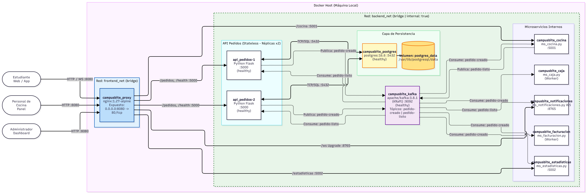

# Diagrama de Despliegue — CampusBite

## Contexto de la Topología

La infraestructura se despliega sobre un **Docker Host** único orquestado mediante **Docker Compose**, aplicando segmentación de red y desacoplamiento de estado:

* **Punto único de entrada (`frontend_net`):** El contenedor **`campusbite_proxy`** (`nginx:1.27-alpine`) es el único servicio con mapeo de puertos hacia el host (`8080:80`). Recibe todas las peticiones externas (HTTP REST y WebSockets) y las enruta internamente mediante el DNS embebido de Docker (`127.0.0.11`).
* **Aislamiento interno (`backend_net`):** Configurada con `internal: true`, bloquea cualquier conexión directa desde el exterior hacia los microservicios, la base de datos o el broker de mensajería.
* **Escalado horizontal *stateless*:** El servicio **`api_pedidos`** se despliega con 2 réplicas (`api_pedidos-1` y `api_pedidos-2`) balanceadas por Nginx en modo *round-robin*, delegando todo el estado transaccional e idempotencia a **`campusbite_postgres`** (`postgres:16.6`), respaldado por el volumen nombrado **`postgres_data`**.
* **Comunicación asíncrona:** **`campusbite_kafka`** (`apache/kafka:3.8.1` en modo KRaft) desacopla el procesamiento mediante los tópicos `pedido-creado` y `pedido-listo`, consumidos por **`campusbite_cocina`**, **`campusbite_estadisticas`**, **`campusbite_notificaciones`**, **`campusbite_caja`** y **`campusbite_facturacion`**.