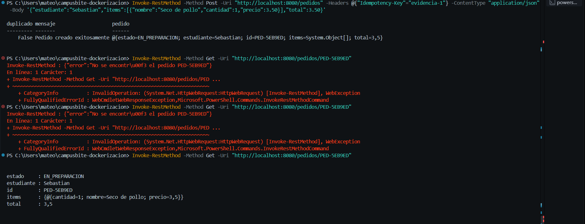
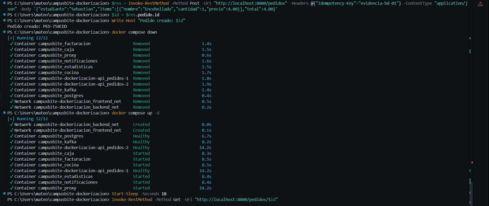
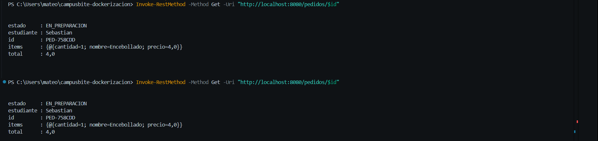
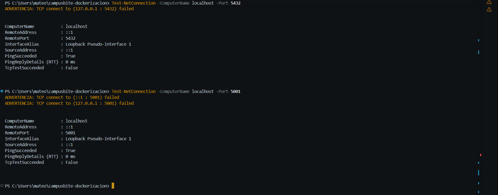
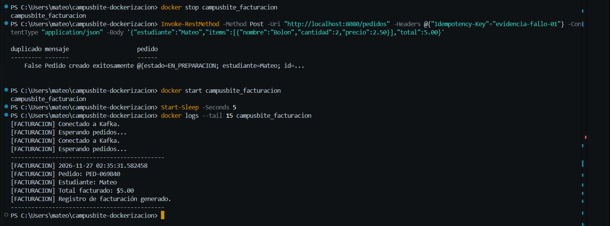

# Reporte de Evidencias de Despliegue y Resiliencia — CampusBite

Este documento registra las pruebas experimentales ejecutadas sobre la arquitectura contenerizada de **CampusBite** mediante Docker Compose, validando el comportamiento ante escalado horizontal, persistencia en base de datos, aislamiento de red y tolerancia a fallos.

---

## Evidencia 1: Inconsistencia de Estado con Réplicas en Memoria

* **Objetivo:** Observar el comportamiento del sistema cuando `api_pedidos` se escala a 2 réplicas (`API_REPLICAS=2`) detrás de Nginx mientras el almacenamiento de pedidos reside únicamente en memoria RAM local de cada contenedor.
* **Procedimiento ejecutado:**
  1. Se envió una petición `POST /pedidos` a través del proxy inverso (`http://localhost:8080/pedidos`) con la cabecera `Idempotency-Key: evidencia-1`, generando el pedido **`PED-5EB9ED`**.
  2. Se realizaron consultas `GET /pedidos/PED-5EB9ED` consecutivas.
* **Resultado observado:**
  * Las dos primeras consultas devolvieron **`404 Not Found`** (`"No se encontró el pedido PED-5EB9ED"`) al ser enrutadas por balanceo *round-robin* hacia la réplica cuya memoria RAM estaba vacía.
  * La tercera consulta devolvió **`200 OK`** al caer nuevamente sobre la instancia que procesó el `POST` inicial.
* **Conclusión técnica:** El almacenamiento en memoria local rompe la propiedad *stateless* exigida para el escalado horizontal, justificando la migración hacia una base de datos externa compartida.



---

## Evidencia 2: Persistencia en PostgreSQL y Consistencia entre Réplicas 

* **Objetivo:** Verificar que los pedidos sobreviven a la destrucción y recreación completa de los contenedores y que ambas réplicas de `api_pedidos` comparten un estado consistente.
* **Procedimiento ejecutado:**
  1. Se creó el pedido **`PED-758CDD`** mediante `POST /pedidos` (`Idempotency-Key: evidencia-bd-01`) con el servicio `postgres:16.6` activo.
  2. Se ejecutó `docker compose down` (eliminando todos los contenedores y redes, pero conservando el volumen nombrado `campusbite-dockerizacion_postgres_data`) y posteriormente `docker compose up -d`.
  3. Tras esperar la inicialización de los `healthcheck`, se ejecutaron dos consultas `GET /pedidos/PED-758CDD` consecutivas.
* **Resultado observado:**
  * Ambas consultas `GET` respondieron **`200 OK`** con la información íntegra del pedido (`PED-758CDD`, estudiante `Sebastian`, total `$4.00`, estado `EN_PREPARACION`), sin producirse errores `404` entre réplicas.
* **Conclusión técnica:** El volumen persistente de PostgreSQL desacopla el ciclo de vida de los datos respecto al de los contenedores efímeros y garantiza consistencia fuerte entre múltiples réplicas de la API.





---

## Evidencia 3: Aislamiento de Red y Punto Único de Entrada

* **Objetivo:** Comprobar que los microservicios internos y la base de datos no son accesibles directamente desde el host, exponiendo únicamente el proxy inverso Nginx en el puerto `8080`.
* **Procedimiento ejecutado:**
  * Se ejecutaron pruebas de conectividad TCP desde PowerShell directamente contra los puertos internos de PostgreSQL (`5432`) y del microservicio de Cocina (`5001`):
    ```powershell
    Test-NetConnection -ComputerName localhost -Port 5432
    Test-NetConnection -ComputerName localhost -Port 5001
    ```
* **Resultado observado:**
  * Ambos comandos arrojaron **`TcpTestSucceeded : False`** (conexión rechazada).
* **Conclusión técnica:** La segmentación en dos redes puente (`frontend_net` y `backend_net` marcada con `internal: true`) reduce la superficie de ataque y obliga a que todo el tráfico externo pase exclusivamente por Nginx (`campusbite_proxy`).



---

## Evidencia 4: Tolerancia a Fallos y Recuperación Asíncrona con Kafka

* **Objetivo:** Validar que la caída de un consumidor secundario no bloquea la recepción de nuevos pedidos y que los eventos pendientes se recuperan automáticamente al restaurar el servicio.
* **Procedimiento ejecutado:**
  1. Se detuvo deliberadamente el contenedor de facturación mediante `docker stop campusbite_facturacion`.
  2. Con el servicio detenido, se registró el pedido **`PED-069B40`** (`Idempotency-Key: evidencia-fallo-01`, estudiante `Mateo`, total `$5.00`) vía `POST /pedidos`.
  3. Se reinició el contenedor con `docker start campusbite_facturacion` y se inspeccionó su salida con `docker logs --tail 15 campusbite_facturacion`.
* **Resultado observado:**
  * La API aceptó y registró el pedido **`PED-069B40`** con código **`201 Created`** sin demoras ni errores mientras `campusbite_facturacion` estaba caído.
  * Al encender nuevamente el contenedor, este se reconectó al broker `kafka:9092`, consumió el evento pendiente desde su último *offset* confirmado y generó automáticamente el registro de facturación correspondiente.
* **Conclusión técnica:** El desacoplamiento temporal mediante Apache Kafka asegura alta disponibilidad en el flujo crítico de creación de pedidos y entrega garantizada (*at-least-once*) ante fallos parciales de componentes.

